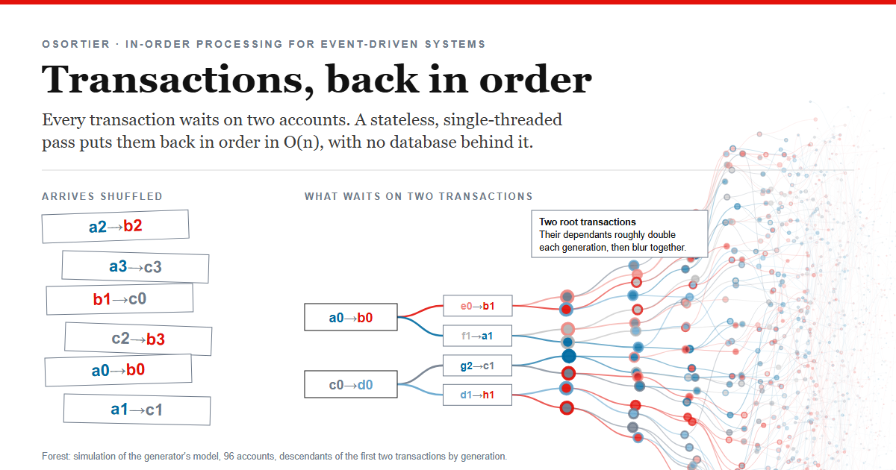
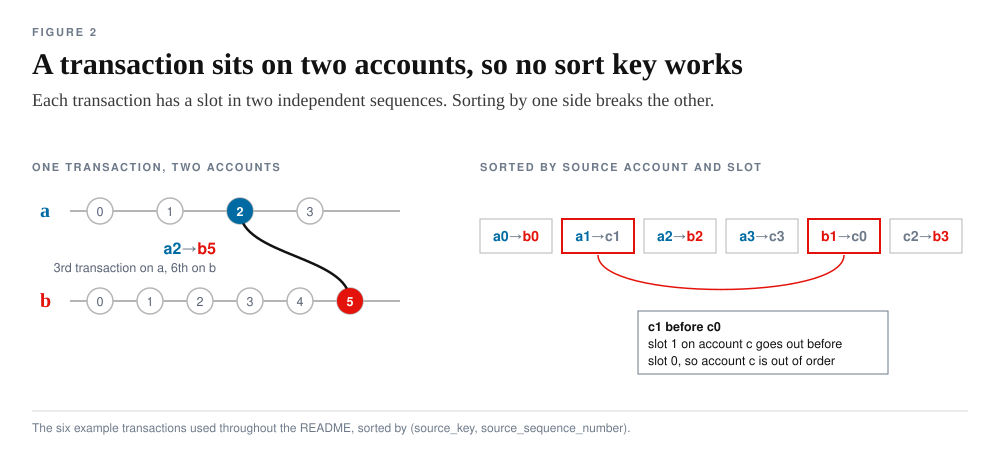
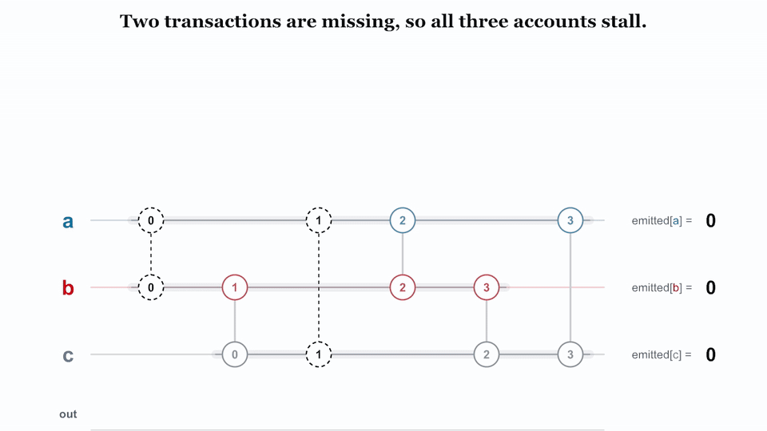
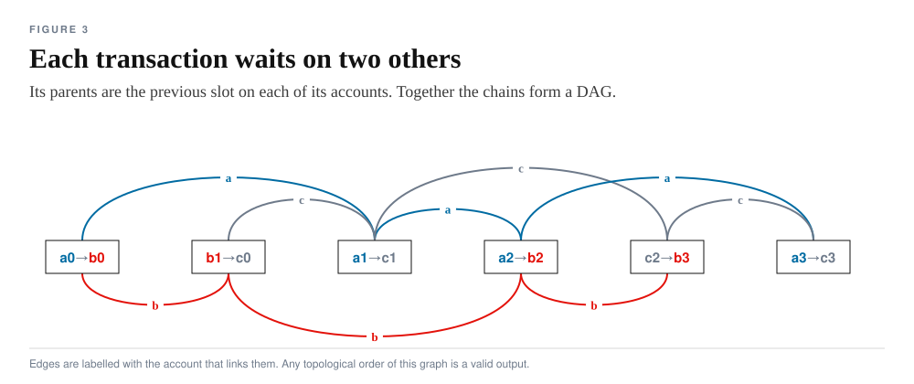

<p align="center">
  
</p>

# Osortier

Osortier is for downstream consumers in transaction-based, event-driven systems that need to process transactions in order. That situation is common: as soon as transactions pass through partitions, retries or parallel workers, they arrive out of order, and a consumer that applies account state cannot use them that way.

Osortier puts the transactions back in an order that is valid for every account. It is stateless and single-threaded, runs in O(n), and needs no database. The ordering comes from the sequence numbers the producer already gives each account's transactions, so everything between producer and consumer can stay unordered and at-least-once.

The repo has the algorithm in Go with tests, a demo on AWS (Lambda, S3 and API Gateway, defined in CDK), and a small Vue site that drives the demo. A two-minute explainer video, [docs/osortier-explainer.mp4](docs/osortier-explainer.mp4), walks through the same ideas as this README. It has no audio, and everything it shows is also described in the text here.


## Stateless by design

Osortier keeps nothing between runs and holds no database. Everything it needs is in its input: each transaction carries its own slot on both of its accounts. Any instance can sort any batch, a crash loses nothing that is not still in the input, and the Lambda in this repo starts every run from empty counters.

The state it uses while running is small: one counter per account plus the transactions that are still waiting. For a continuous stream, that carry-over would be written next to the output and read back as part of the next input, which keeps the sorter itself stateless. The demo sorts self-contained sessions, so this carry-over is not built yet.

It runs on one thread on purpose. Every transaction crosses two accounts, so splitting the work by account would mean coordination between shards on nearly every transaction. One thread at about 200k transactions per second (measured below) handles roughly 17 billion transactions a day. A parallel version is possible, but only extreme volumes would need it.

The guarantee is a causal order per account: every account gets its transactions in exact sequence, and no transaction is released before the two it depends on. Two accounts that never share a transaction have no fixed order relative to each other.

## The problem

The model is double-entry: each key is an account, and each transaction moves value between two accounts. The original case was real-time stockkeeping. A transaction carries both the change and the new state of both accounts, so each account's transactions must be applied in exact sequence. The producer owns those accounts and numbers each one's transactions from 0 without gaps.



Each transaction has two positions in two independent sequences, so no single sort key ranks them, and sorting by one side breaks the other.

A gap also spreads. If a0→b0 is missing, accounts a and b both stall. Then b1→c0 cannot go out, so c stalls too, although nothing on c is missing.



The six transactions arrive as a2→b2, a3→c3, b1→c0, c2→b3, a0→b0, a1→c1 and go out as a0→b0, b1→c0, a1→c1, a2→b2, c2→b3, a3→c3. That is the output of `sortEvents` on this input (checked 2026-11-06).

### The problem class

Each account's sequence is a chain, and each transaction is a node on two chains with at most two parents, the previous slot on each of its accounts. The chains form a DAG, and any topological order of it is a valid output.



Every transaction is cross-account. Double entry requires it, and the generator enforces it. That has consequences:

- Accounts cannot be split into separate streams, because every transaction welds two chains together.
- Following parents back, positions only decrease, so there are no cycles. Every transaction descends from a double genesis, a transaction at slot 0 on both sides. With random account pairs, the input becomes one connected web whose descendants roughly double per generation (2, 4, 8, 16, 29, 51, 80, 118 in a 96-account simulation of the generator's model, shown in the image at the top).
- Chains braid. A transaction can be the child of the same parent on both sides, as with a0→b0 followed by a1→b1. Both wake-ups then point at one transaction, and it must still go out once.

Sorting a DAG while its nodes arrive in random order is an online topological sort. Related problems:

| Problem | Relation |
| --- | --- |
| Stream resequencing (TCP reassembly, per-partition order in Kafka) | The one-chain case. Two chains per transaction is what makes this one harder. |
| Causal delivery with vector clocks | Same shape: a message waits until its dependencies are delivered. Here every transaction has exactly two. |
| Kahn's topological sort | The general algorithm. Osortier is Kahn's with in-degree at most 2, where a child is found by a hash lookup on its slot, so the graph is never built. |

## The algorithm

![The loop: next transaction, then a ready check on both preconditions. If not ready, park it under both slots. If ready, emit it, advance both counters, and wake: look up the next slot on each of its accounts and emit what is now ready there. Below, the two stores after the fifth arrival in the animation above: counters a 1, b 2, c 1, and a backlog holding a2→b2 (waiting on a at 2, b at 2 met), a3→c3 (both waiting) and c2→b3 (both waiting). On the sixth arrival, a1→c1 moves a to 2, which releases a2→b2.](docs/fig-loop.svg)

Every waiting transaction has two preconditions: each of its accounts has to reach its slot. Two stores track them. The counters hold the next slot each account expects ([go/sequenceCounter.go](go/sequenceCounter.go)). The backlog holds the waiting transactions, stored under both of their slots ([go/backlog.go](go/backlog.go)), so the transaction behind any slot is one lookup away. [go/main.go](go/main.go) walks the input once.

A parked transaction becomes ready only when its last missing parent is emitted. So after each emit, the walker checks the two slots that follow it and never scans the backlog. The cascade runs on an explicit queue, so a chain of any depth drains without recursion. The queue holds transactions that were just emitted, which means a transaction woken twice still goes out once.

Each transaction is parked at most once and emitted at most once, and each emit costs two hash lookups, so time is O(n). Memory is one counter per account plus the current backlog.

## Release comes in bursts

A late transaction releases its whole parked subtree, meaning every descendant whose other parents are already out. Because the transactions form one web, that subtree can be most of the backlog. The output alternates between long quiet stretches and sudden floods, and how far transactions are out of place decides how big the floods get. Measured on 1M synthetic transactions over 29 accounts:

| Input order | Largest single wave | Peak backlog |
| --- | --- | --- |
| shuffled within blocks of 100 | 95 transactions | 94 |
| shuffled within blocks of 1,000 | 977 | 984 |
| shuffled within blocks of 10,000 | 9,972 | 9,973 |
| shuffled within blocks of 100,000 | 96,229 | 99,816 |
| fully shuffled | 923,005, which is 92% of the input | about the whole input |

With full shuffling, 19 of the 1,000,020 arrivals released anything. A second fully shuffled run had 20 releasing arrivals, and its last arrival released 878,536 transactions. With 999 accounts the largest wave was 469,105, spread over 512 releasing arrivals. Wave size and backlog follow the width of the disorder, and the size of the input does not change them.

For operation, that means two things. The downstream consumer has to be sized for waves, because one very late root releases everything behind it at once. And small windows keep the backlog and the waves about as large as the disorder in them.

The tests cover this on constructed input. `TestLateGenesisArrivesLast` holds the root back until last and checks that it flushes the backlog in order, and `TestDeepChainWorklist` drains a shuffled chain of 100k transactions without recursion.

## Performance

| Transactions | Accounts | Order | Time | Throughput |
| --- | --- | --- | --- | --- |
| 3,000,000 | 29 | fully shuffled | 14.7 s | about 200k/s |
| 3,000,000 | 999 | fully shuffled | 15.2 s | about 200k/s |
| 10,000,020 | 29 | fully shuffled | 53.4 s | about 190k/s |

The numbers come from a scratch harness around `sortEvents`, not committed, run on 2026-11-06 with go1.22.1 on one thread of an AMD Ryzen 7 3700X. The input came from the generator, and every output was checked to be gap-free on every account. The burst figures come from the same harness. Time grows linearly with input size and does not depend on the number of accounts.

Two figures in this project are not measurements. The demo site's cost of about $0.28 per month for 900M transactions is arithmetic from an assumed 83k transactions/s on 2 GB of Lambda memory. The claim that 30M transactions per month with light batching fits in the AWS free tier is the project's target.

## Inconsistent input

| Case | Behaviour |
| --- | --- |
| A transaction never arrives | Its descendants wait. Nothing is dropped or released out of order. With Kafka as the source the gap is visible in Kafka itself, and the sorter logs only how many transactions it emitted, parked and rejected. |
| A parked transaction is delivered twice | Ignored, including the form with source and destination swapped. |
| A transaction is replayed after it went out | Its slot has passed, so it parks. It cannot go out twice, and the parked count shows the replay. |
| Two different transactions claim one slot | The first claim wins and the second is counted as a conflict. |

After the input ends, the walker makes one more pass over the backlog. On consistent data it changes nothing, which a randomized differential test in [go/sorter_test.go](go/sorter_test.go) checks, and it stays in as a safety net.

## Trade-offs

A transaction that never arrives leaves its descendants waiting indefinitely, and the source is where that gap shows. Memory follows disorder, so a fully shuffled batch parks nearly all of its input before it drains.

The SQL approach this replaces has real strengths: durable, queryable, transactional state and operations every team knows. Osortier gives those up for speed, cost and a design with no state to manage.

## Where it comes from

The idea comes from a consulting engagement at a large e-commerce retailer running real-time stockkeeping on a double-entry model. Out-of-order streams were ordered in SQL there, with a sort plus a grouping on a database instance, reported at about 5k per month and under 1M transactions per day. Osortier moves the same release logic into plain Lambda compute with S3 as the only store. The engagement figures are not reproduced here.

## Demo deployment


| Function | Memory | Request |
| --- | --- | --- |
| gen | 4096 MB | POST /events?session=s&num=n writes n shuffled transactions, at most 10M, to the store |
| sort | 4096 MB | POST /sort?session=s loads them, sorts them and writes s/sorted_events.json |
| get | 1024 MB | GET /events?session=s checks that the sorted file exists and returns its S3 URL, hardcoded to eu-central-1 |

Both buckets are public, CORS is open and the buckets are deleted with the stack, so the demo is for demo data only.

## Repo layout

| Path | Contents |
| --- | --- |
| [go/](go/) | the algorithm, a standalone runner that generates 3M transactions, sorts them and writes files, and the tests |
| [go_lambda/](go_lambda/) | the gen, sort and get handlers, each with its own Go module and copy of the core files |
| [cdk/](cdk/) | the stack: buckets, functions, REST API and site deployment |
| [demo_site/osortier/](demo_site/osortier/) | the Vue demo site |
| [docs/](docs/) | the figures and the link preview, generated by [docs/figures/make_figures.py](docs/figures/make_figures.py), plus the explainer video and the cascade GIF, whose Kinetograph source is in [docs/animation/](docs/animation/) |
| [python/](python/) | the earlier SQL experiment, a Postgres docker-compose and generators; sort_events_pg.py is empty |

## Build and run

```sh
cd go && go test ./...    # duplicates, conflicts, missing transactions, deep chains, randomized differential tests
cd go && go run .         # writes ../data/shuffeled_events_go.json and ./sorted.json (../data must exist)

# per Lambda folder, module name from its go.mod
go build -o bootstrap <module> && zip lambda-handler.zip bootstrap

cd demo_site/osortier && npm run build     # CDK deploys this dist folder
cd cdk && npm run build && cdk deploy

python docs/figures/make_figures.py        # regenerates every figure in docs/
```

The site serves docs/og-image.png as /assets/og-image.png for link previews, with Open Graph and Twitter tags in demo_site/osortier/index.html. Most crawlers need an absolute image URL, so set VITE_SITE_URL in demo_site/osortier/.env to the public origin before building.

## Known issues

- The demo cannot get from generate to sort. gen writes unsorted_events.json, while sort and the site read unsorted_session_data.json ([go_lambda/gen/main.go:101](go_lambda/gen/main.go#L101), [go_lambda/sort/main.go:156](go_lambda/sort/main.go#L156)).
- The committed lambda-handler.zip files date from June 2024 and predate the current go_lambda/sort source, which matches go/. Rebuild them before deploying.
- Slot keys can collide. A slot key is the account key and the slot number joined without a separator, so account x1 at slot 2 and account x at slot 12 both become "x12", and the second transaction is wrongly rejected as a conflict (reproduced 2026-11-06). The demo's one-letter keys never hit this, but account IDs ending in a digit would. A separator that cannot occur in a key, or a struct key, fixes it.
- The site's "Unsorted" button links to the sorted file.
- Only go/ has tests. The CDK test is the default from the CDK project template.
